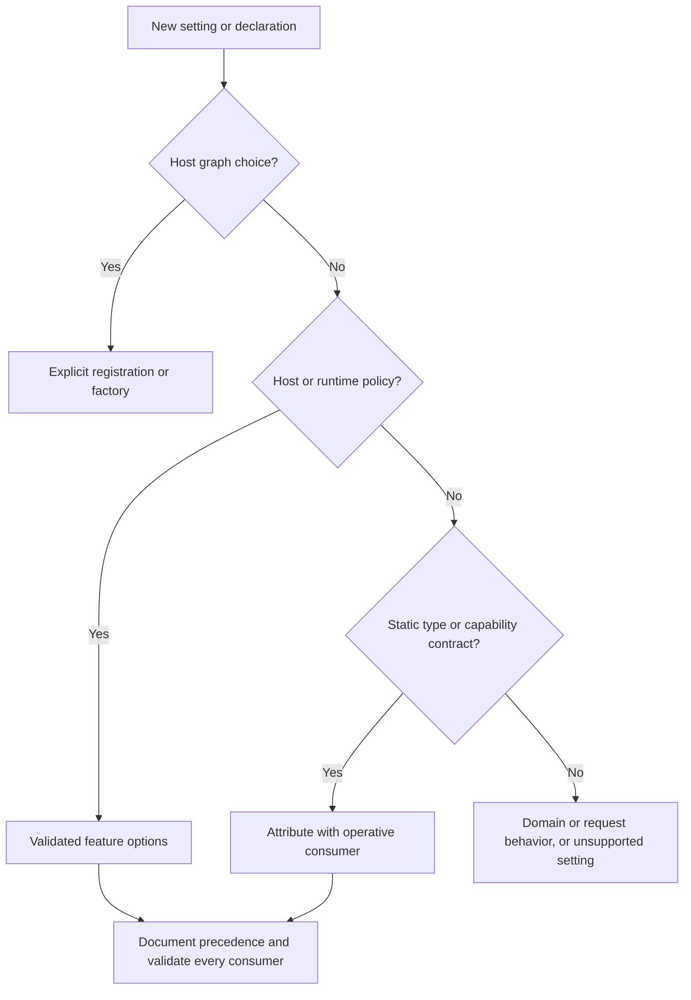

# ADR-0002: Separate Metadata From Host Composition

## Context and Problem Statement

Mississippi needs one responsibility model for registrations, options, and
attributes. On the audited main revision, `GenerateAggregateEndpoints` contains
both `RoutePrefix` and `FeatureKey`, and the runtime registration generator also
discovers that marker. An author cannot select generated runtime composition
without understanding an HTTP-oriented marker's additional roles.

The existing service-registration guidance also asks every registration for
action, configuration, and explicit-parameter overloads. That rule applies even
when a feature has no options or only one required type identity. The shipped
`RuntimeBuilder` and `ClientBuilder` already provide host facades; replacing them
would add a separate composition migration without resolving metadata ownership.

The question is how an author chooses where a new setting belongs, which
consumer implements it, and how host policy constrains a static declaration.
This decision crosses runtime, gateway, client, generators, and persisted
identity contracts.

## Decision Drivers

- Preserve explicit host composition and the shipped builder entry points.
- Support runtime-only, HTTP-only, and MCP-only generation choices.
- Keep source declarations independent of deployment secrets and provider choice.
- Require an operative consumer for every supported public setting.
- Preserve persisted identities during ordinary API refactors.
- Keep cohesive static settings together without coupling unrelated capabilities.

## Considered Options

- Retain endpoint markers as composite selectors for runtime and transports.
- Move all type metadata into host registrations and options.
- Separate registrations, options, and focused static attributes by responsibility.

## Decision Outcome

Chosen option: "Separate registrations, options, and focused static attributes by
responsibility", because it preserves useful type metadata while giving the host
explicit ownership of composition and effective runtime policy.

The canonical author rules, decision tree, consumer worksheet, and precedence
matrix live in
[the canonical guide at the reviewed revision](https://github.com/Gibbs-Morris/mississippi/blob/e7ae036c6db5ac4601bbae00040a004a897746fd/.github/instructions/metadata-and-composition.instructions.md).
This immutable source link works before merge and after the proposing branch is
deleted. The guide is a repository instruction outside the Docusaurus document
map; links between ADRs remain relative. This ADR records the rationale and does
not duplicate the instruction rules.

Registration chooses services, implementations, lifetimes, host capabilities,
and assembly discovery. Generated Add helpers remain explicit calls. Options
configure host/runtime defaults and tuning through the normal options pipeline.
Attributes describe immutable type identity, workflow relationships, one
generated capability, or one static contract.

The responsibility model is summarized below. Deployment endpoints and static
wire routes take different branches; the surrounding explanation is authoritative.

A type can provide a tunable default only when host options own its override.
Snapshot retention already does this: stable storage-name override, CLR-name
override, type retention attribute, then the host default. Access policy needs
its own boundary-specific precedence; there is no universal attribute-wins rule.

This record remains **Proposed**. The canonical guide applies to approved issue
or execution contracts that explicitly adopt it, including authorized work in
programme #1127. Global discovery does not establish repository-wide adoption;
that activation requires actual ADR acceptance through the existing lifecycle.
Programme approval, publication, or merge alone does not establish acceptance.
API migrations remain planned until their implementing PRs land; writing this
record does not change generated or runtime behavior.

### Consequences

- Authors can classify each setting and identify its operative consumer before
  adding a public API member.
- Independent capability markers allow hosts to select only the adapters they
  need, once the planned migrations are implemented.
- More focused declarations add some annotation ceremony; cohesive fields such
  as policy, roles, and authentication schemes stay together.
- Every affected generator, runtime reader, sample, and document needs migration
  and consumer-level proof in its implementing PR.
- Source renames preserve stored brook/event/snapshot identities, aliases,
  versions, and constructed generic names. Separate alias and schema-evolution
  decisions are still required where behavior actually changes.

### Confirmation

A01 review checks classify the seven issue examples, reconcile instruction
conflicts, verify current symbol names and planned labels, and map R1-R7 to
documentation evidence. Markdown lint, instruction discovery, link checks, and
the Docusaurus build/browser suite validate this policy slice.

The child PRs provide executable generated-consumer and runtime proof, including
capability absence, effective options, source/reference discovery, and real
authorization boundaries. Documentation review does not establish those passes.

## Pros and Cons of the Options

### Retain Composite Endpoint Markers

This keeps the existing annotation count and source surface. It also retains
HTTP naming for runtime-only consumers and mixes routing with client identity.

### Move All Metadata Into Host Configuration

This gives the host one configuration location. It moves immutable identity and
workflow relationships away from their types and requires hosts to repeat them.

### Separate Responsibilities

This preserves immutable type facts and cohesive contracts while making host
choices explicit. It costs a coordinated, tested migration of current consumers.

## More Information

- [ADR lifecycle](index.md#adr-lifecycle)
- [Attribute programme #1127](https://github.com/Gibbs-Morris/mississippi/issues/1127)
- [A01 contract #1128](https://github.com/Gibbs-Morris/mississippi/issues/1128)
- [Shipped client composition](../reference/client-composition.md)
- [Shipped runtime composition](../reference/runtime-composition.md)
